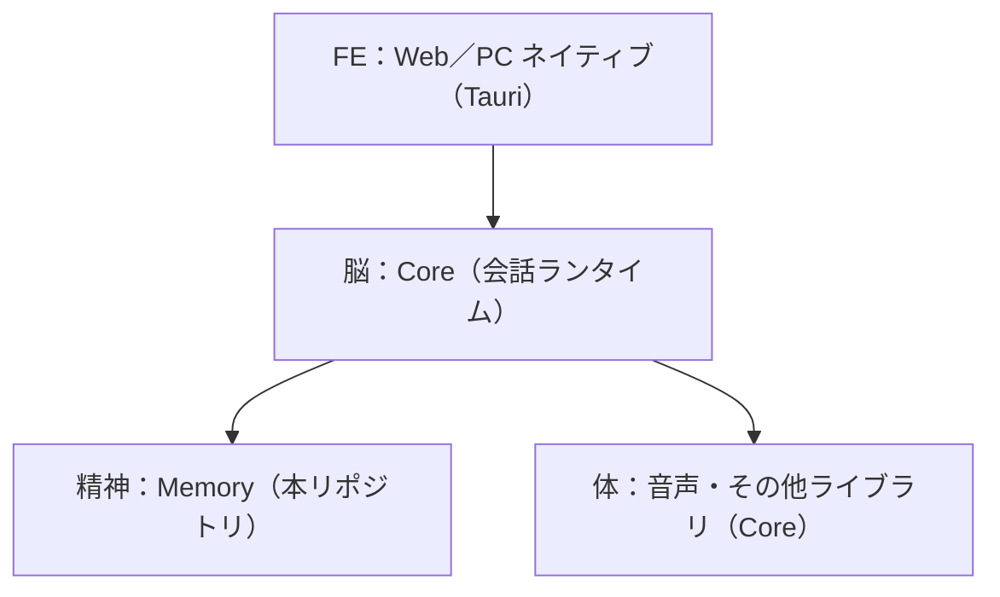

# 0015. 会話ランタイムは Core、記憶と成長は Memory に分け、Memory は Core からだけ呼ばれる

- 日付：2026-10-20
- 状態：承認

## 背景

digital-souls は次の構成をとる。

既存の digital-souls-core には会話ランタイムに加えて、記憶の保存・意味検索・機微分類が実装されている。0003 では本サービスを「複数の窓口から呼ばれる独立サービス」としていたが、窓口（FE）と本サービスの間に Core が入ることになった。

## 決定

- Core は会話ランタイム（応答生成、音声などの体、窓口との接続）として残る。
- 本サービス（Memory）は、記憶と経験によるキャラクターの成長を提供するサービスとして Core から切り出す。
- Memory を呼ぶのは Core だけとする。FE や外部アプリは Memory を直接呼ばない。窓口の種類（Web／Windows／配信／ゲームなど）は、Core が Turn の surface として渡す。
- Core 向けの薄いクライアントは Python で提供する。
- Core の意味検索（記憶検索）は Memory へ移設する。Core で採用した embedding（Core ADR 0024 の bge-m3）と評価資産は、0007 の比較の出発点にする。
- 機微情報の判定は Core に残し、登録前に Core が行う（0016）。
- AIRI はデスクトップアプリの参考にするだけで、Memory とも Core とも直接は接続しない。
- 既存 digital-souls のデータは開発時のものなので移行せず破棄する。

## 検討した案

以下は今回の決定と代替構成の比較説明であり、過去に各案が明示提案されたことを示す記録ではない。

- **ライブラリとして Core に組み込む**：疎結合の方針に反し、成長の遅いループ（内省・人格更新）を会話ランタイムと別プロセスで動かせないため不採用。
- **各窓口から Memory を直接呼ぶ（0003 当初の想定）**：窓口ごとに認証・機微判定・想起の約束事が分散するため不採用。窓口は Core に集約する。
- **AIRI から直接接続する**：AIRI は参考実装として扱うだけで、接続先にはしない。
- **意味検索を Core に残す**：記憶検索は Memory の責務であり、検索スコア（0012）と出典の扱いを Memory で一貫させるため移設する。
- **TypeScript のクライアント**：利用者が Python の Core だけになったため不要。
- **既存データを原文が残る範囲で取り込み、要約のみのものは出典なしの派生記憶として区別する**：開発時のデータで価値がないため不採用。

## 影響

- 0003・0004・0009・0013 の「利用サービス」「利用側」は Core を指すと読み替える。
- Core 側には、記憶検索を Memory のクライアント呼び出しに置き換える移行作業が発生する。
