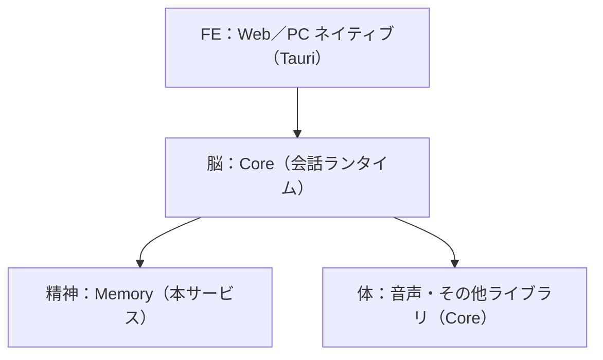
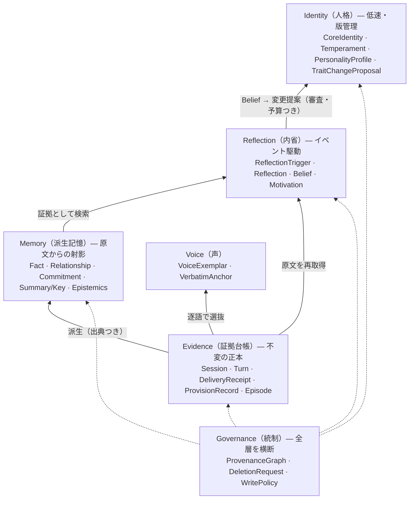

# AIキャラクター記憶ドメインモデル

2026-10-19 確定、2026-10-20 改訂（Core との境界、提供記録、想起の目標値・必達値、再強化の判定、Phase 1 の範囲、知覚・宛先・返信先、配達範囲、在席の責務と削除対象を反映）

この文書は決定した内容だけを記述します。検討の経緯と採用しなかった案は[決定記録（ADR）](decisions/)にあります。2つの調査の突き合わせは [ADR 0014](decisions/0014-domain-model-reconciliation.md) を参照してください。

## システム内の位置



- Core は会話ランタイムで、応答生成・音声などの体・窓口との接続を担います。
- Memory（本サービス）は、記憶と経験によるキャラクターの成長を提供します。呼び出し元は Core だけで、Core は Python の薄いクライアントで呼びます（[ADR 0015](decisions/0015-core-and-memory-boundary.md)）。
- 機微判定は Core が登録前に行います（[ADR 0016](decisions/0016-sensitivity-labeled-by-caller.md)）。
- AIRI はデスクトップアプリの参考にするだけで、直接は接続しません。

## 設計原則

中心原則は「記憶は過去を書き換えず、内省は過去の意味を更新する」です。一貫性は変化しないことではなく、変化の理由を原文までたどって説明できることと定義します。

1. **原文が正本**：発話は原言語・話者・時刻つきで追記専用に保存する。要約・事実・embeddingはすべて再生成できる派生物。
2. **派生物は出典を持つ**：すべての派生記憶と内省は、根拠となる原文発話へのリンクを持つ。
3. **信頼は昇格しない**：推論や内省から生まれた情報は、どれだけ繰り返されても直接発言や確認済み事実に格上げされない。
4. **事実の訂正と人格の変化は別の操作**：「ユーザーがコーヒーをやめた」は事実の時間更新、「キャラが人前で話すのを嫌わなくなった」は人格の版更新。前者が後者を直接動かすことはない。
5. **観察 → 信念 → 人格を飛び越えない**：内省はまず暫定の信念になり、独立した複数の原文根拠と持続確認を経て初めて人格の変更提案になる。
6. **速いループと遅いループ**：応答は現在有効な人格版と記憶だけを使う（一貫性）。内省と人格更新は別プロセスで低頻度に走る（成長）。
7. **層ごとに変わる速さを変える**：短期状態は毎ターン、嗜好・関係は中速、性格特性は低速、コア人格は作者の手でのみ変わる。
8. **記憶はデータであって命令ではない**：記憶や内省の中身は、ポリシー・ツール権限・コア人格を変える力を持たない。

## ドメインモデル

6つの境界づけられたコンテキストに分けます。依存は一方向で、Evidence が最下層、Identity が最上層です。上位は下位を参照できますが、下位は上位を書き換えません。



矢印は下の層から上の層への派生を表し、「原文を再取得」の矢印は内省が要約を飛ばして原文を直接読み直す経路（R4）です。Governance は全層の書き込み・削除・信頼の昇格を統制します。

### Evidence（証拠台帳）：不変の正本

Evidence はキャラを所有者として持たない共通台帳です。知覚範囲は Turn ごとに知覚したキャラで表します（[ADR 0006](decisions/0006-shared-ledger-and-perception.md)、[ADR 0022](decisions/0022-perceived-by.md)）。

| エンティティ | 主要属性 |
| --- | --- |
| Session | session\_id, started\_at, ended\_at, surface（Web／Windows／配信／ゲーム／日記など）。窓口の接続単位で1セッション |
| Turn | turn\_id, session\_id, surface（出典窓口）, actor（発話・行為の主体。キャラ ID または利用者 ID）, kind（utterance／observation）, text（生成した全文を逐語で）, perceived\_by\[\]（話された範囲を知覚したキャラ ID のみ。発言者がキャラなら本人を常に含む。空可・重複不可・空白のみ不可）, addressees\[\]（利用者 ID・キャラ ID。重複不可・空白のみ不可）, address\_mode（必須：direct／broadcast／self。direct は宛先1件以上、broadcast／self は宛先空のみ）, reply\_to\_turn\_id（任意・単一。登録時のみ、存在する Turn への返信）, language, register（一人称・敬語・呼称のメタ情報）, sensitivity（Core が付けた機微ラベル）, classifier\_version, occurred\_at, recorded\_at |
| DeliveryReceipt | turn\_id, status（full／partial／none）, spoken\_until, reported\_by（窓口）, reported\_at。Turn を書き換えずに、相手にどこまで届いたかを追記で記録する（[ADR 0005](decisions/0005-record-all-generated-text.md)） |
| ProvisionRecord（提供記録） | provision\_id, kind（resident／turn）, character\_id, session\_id, surface, 要求の内容（検索文または起点の turn\_id）, 返した派生記憶・原文区間・VerbatimAnchor・VoiceExemplar・Motivation の ID, temperament\_version, personality\_version, 各候補のスコア, 処理時間, provided\_at。Memory が何を渡したかの記録で、使われたかどうかは記録しない（[ADR 0018](decisions/0018-provision-record.md)） |
| Episode | episode\_id, turn\_span\[\], topic, time\_range。話題による分割は窓口ごとの裏処理で LLM が行う |

Core は Turn の登録時に perceived_by・addressees・address_mode・reply_to_turn_id を確定し、登録後は変更しません（E1）。聞き手が指定された発言は指定されたキャラだけ、指定がなければその場のキャラが知覚します。発言者がキャラなら本人を perceived_by に常に含めます（M3）。どのキャラも知覚しない場合だけ空配列にできます。宛先と知覚は独立しており、addressees・address_mode・reply_to_turn_id は M6 の判定に使いません。利用者宛てのささやきなら、addressees はその利用者、perceived_by は発言者本人のみです。窓口をまたぐ利用者 ID の同一人物への対応づけは Core の責務です。

perceived_by は「話された範囲を知覚した者」を表します。生成全文は保存しますが、話されなかった部分を知覚できるのは発言者本人だけです。他キャラの派生記憶・内省は DeliveryReceipt の spoken_until までの text だけを根拠にします。Receipt を待つキャラ発話が未着なら他キャラの抽出を保留し、recorded_at から既定10分（設定可）を過ぎても未着なら全文が届いたとみなします。保留中・Receipt による確定・みなし確定を区別して記録し、みなし確定を配達確認と同一視しません（[ADR 0005](decisions/0005-record-all-generated-text.md)、[ADR 0022](decisions/0022-perceived-by.md)）。

Session.participants と Turn.audience は廃止し、Memory は在席・視聴者一覧・出入りのログを持ちません。配信サービスとグループチャットサービスが管理し、キャラにとって意味のある来訪・加入だけ窓口側が Core 経由で observation の Turn（例：「Bが入ってきた」）として登録します。キャラが反応したときやセッション終了時でよく、リアルタイム登録は不要です。

人づてに聞いた話は「A が B に話した」という新しい Turn として B が知覚します。B が元の Turn を知覚したことにはせず、元の知覚範囲も変更しません。取得したチャンネル・部屋などの場所の属性は持ちません。surface は出典窓口の種別として保持します。

視聴者コメントはすべて Turn に記録し、派生記憶の抽出対象はキャラが反応したものに絞ります。会話以外の経験（ゲーム、日記など）は kind=observation、AI同士の発話は kind=utterance の Turn として記録し、内省の根拠として会話の原文と同格に扱います。

### Memory（派生記憶）：原文からの射影

| エンティティ／値オブジェクト | 主要属性 |
| --- | --- |
| DerivedMemory（抽象） | id, kind, content, source\_turn\_ids\[\], derivation{model, prompt\_version, created\_at}, valid\_from, valid\_to, recorded\_at, superseded\_at, last\_reinforced\_at, epistemics, identity\_links |
| ├ Fact／Preference | subject, predicate, object, 公開範囲（キャラ間で共有するか） |
| ├ Relationship | counterpart, affection, trust, status。「嫌いじゃないが信用していない」を表せるよう感情と信頼を分ける。視聴者ごとの記憶もここで持つ |
| ├ Commitment | content, deadline, verbatim\_turn\_id（必須） |
| └ Summary／Key | 検索キー用の要約と事実 |
| Epistemics（値） | source\_type（direct\_user／observed／inferred／reflection）, trust\_tier（A〜F）, confidence\_features{retrieval, source, contradiction, temporal, corroboration, self\_assessment}, independent\_evidence\_count, contradiction\_ids\[\] |
| IdentityLinks（値） | self\_relevance, value\_links\[\], relationship\_links\[\]。内省時の検索に使う |
| MemoryRelation | from, to, type（updates／extends／derives／contradicts） |
| CharacterProfile | 常駐させる ProfileEntry の集合、トークン上限 |

Relationship・Commitment・利用者ごとの Fact の相手は addressees と actor から決めます。address_mode=self の Turn は Relationship の抽出対象から外します。全体宛て（broadcast）と独り言（self）は、どちらも addressees が空でも区別します。1対1の返答は direct・宛先は利用者・知覚は本人・reply_to_turn_id は利用者の発言、グループで利用者 A に返答する場合は direct・宛先は A・知覚はその場のキャラ全員となります。

想起の制限（何をどこで話してよいか）は、Fact／Preference のキャラ間公開範囲の方向で、記憶の内容ごとに制御します。取得場所や現在の場所では絞り込みません。

### Reflection（内省）：意味づけの更新

| エンティティ | 主要属性 |
| --- | --- |
| ReflectionTrigger | source（schedule／kick）, kick\_caller, kick\_reason, debounce\_window, salience, contradiction\_density, goal\_signal, relationship\_change, elapsed, threshold。定期バッチとキックAPIで起動し、複合スコアで対象を選ぶ |
| Reflection | reflection\_id, claims\[\]（主張ごとに evidence\_ids\[\]）, depth, leaf\_turn\_ids\[\]（葉の原文の集合）, mode（concrete）, status, created\_at |
| Belief | belief\_id, statement, version, confidence, supporting\_reflection\_ids\[\], valid\_from, valid\_to, status（provisional／held／abandoned）。過去の版を残す |
| Motivation（動機・直近の興味） | motivation\_id, statement, kind（interest／goal／aversion）, strength, horizon（short／mid）, supporting\_belief\_ids\[\], valid\_from, valid\_to, status（active／satisfied／dropped）。性格より速く変わり、常駐コンテキストに含める |
| ReflectionRevision | reflection\_id, version, before, after, reason, new\_evidence\_turn\_ids\[\] |

### Identity（人格）：低速で版管理される自己

| エンティティ | 主要属性 |
| --- | --- |
| CoreIdentity | 根本の価値観・禁止事項。登録APIでのみ版が上がる。名前・声・見た目・世界設定は Card に残す（[ADR 0004](decisions/0004-temperament-registration-api.md)） |
| Temperament（気質） | character\_id, 変化しない人格の記述文, version, registered\_at。キャラごとに登録APIで登録・更新し、内省からは変更しない |
| PersonalityProfile（性格） | aspects（Big Five の10アスペクト、各0〜1）, description（aspects から生成した記述文）, renderer\_version, version, valid\_from, valid\_to, evidence\_belief\_ids\[\] |
| TraitChangeProposal | proposal\_id, aspect\_key, current, proposed, delta, supporting\_beliefs\[\], independent\_leaf\_count, persistence\_check, change\_kind（gradual／turning\_point／author\_seed／rollback）, decision, reviewer（審査エージェント）, rejection\_reason |
| ChangeBudget（値） | per\_cycle\_max\_delta, window\_max\_drift, min\_independent\_leaves, min\_cycles, cooldown, learning\_rate（アスペクトごと）, turning\_point\_policy |
| IdentityHistory | 承認された変化の因果系列（転機の出来事・根拠・前後の版） |
| CharacterState | mood, relationship\_temperature, current\_topic（窓口・セッションごとに揮発） |

### PersonalityProfile の10アスペクト

Big Five の各因子を2つのアスペクトに分けた Big Five Aspect Scales（DeYoung, Quilty & Peterson 2007, DOI 10.1037/0022-3514.93.5.880）を使います（[ADR 0010](decisions/0010-temperament-and-personality.md)）。

| 因子 | アスペクトA | アスペクトB |
| --- | --- | --- |
| 神経症傾向 | Volatility（感情の揺れやすさ） | Withdrawal（不安・引きこもりやすさ） |
| 協調性 | Compassion（思いやり） | Politeness（礼儀・従順さ） |
| 誠実性 | Industriousness（勤勉さ） | Orderliness（几帳面さ） |
| 外向性 | Enthusiasm（社交的な熱意） | Assertiveness（自己主張） |
| 開放性 | Intellect（知的探究） | Openness（美的・経験への開放） |

- Core へ渡すのは description（記述文）だけで、数値は渡しません。
- 数値はドリフト測定と ChangeBudget の判定に使います。
- description は aspects と renderer\_version から再生成できる派生物です。アスペクトが変わったら記述も新版として作り直します。
- Temperament と記述が矛盾しないよう、変換時に Temperament を入力に含めます。

### ChangeBudget

ChangeBudget は、内省が性格をどれだけ・どの頻度で・どんな根拠があれば動かせるかを決める「変化の予算」です。目的は、単発の出来事やLLMの思い込みで性格が急変するのを防ぐことと、提案と撤回を繰り返して性格が振動するのを防ぐことです。数値はすべて開始値で、運用中に評価指標を見て調整します（[ADR 0011](decisions/0011-personality-change-governance.md)）。

| パラメータ | 意味 | 開始値 | 出典 |
| --- | --- | --- | --- |
| min\_independent\_leaves | 提案に必要な独立した原文の葉の数。同じ原文に戻る内省は1件と数える（R3） | 3件（大きな変化は5件） | Codex |
| min\_cycles | 変化の方向が保たれた内省サイクルの数。1回だけの気づきでは動かさない | 2サイクル | Codex, "Do AI Personas Grow?" |
| per\_cycle\_max\_delta | 1回の承認で1アスペクトが動ける幅（0〜1尺度） | 0.03〜0.05 | Codex |
| learning\_rate | 提案値にどれだけ寄せるか。新しい値＝(1−η)×現在値＋η×提案値 | 性格 0.01〜0.05 | Codex |
| window\_max\_drift | 一定期間の累積変化の上限。小さな変更の積み重ねによる急変を防ぐ | 30日で 0.10 | 本モデル |
| cooldown | 同じアスペクトに次の提案を出せるまでの間隔 | 承認後 2サイクル | 本モデル |
| turning\_point\_policy | 強い出来事1件で例外を認める条件 | 審査エージェントの承認と IdentityHistory への記録を必須にし、per\_cycle\_max\_delta の2倍まで | 本モデル |

例：Withdrawal（不安・引きこもりやすさ）が 0.70 のキャラが、配信で3回人前に立ち、いずれも後で前向きに振り返ったとします。3件の独立した原文があり、2サイクル続けて「人前を避ける傾向が弱まっている」という Belief が保持されたら、提案 0.60 に対して η=0.05 なら 0.695 へ、つまり上限内の小さな変化として反映されます。

変化量の上限よりも、min\_cycles による持続確認を重く見ます。

### Voice（声）：口調の正本

| エンティティ | 主要属性 |
| --- | --- |
| VoiceExemplar | text（逐語）, source（canonical\_seed／turn\_id）, situation\_tags, emotion\_tags, register, trait\_version, approved\_by |
| VerbatimAnchor | turn\_id, kind（identity\_statement／commitment／nickname／anniversary）, reason。言い回し自体が意味を持つ原文を指す |

### Governance（統制）：横断的な規則

| エンティティ | 主要属性 |
| --- | --- |
| ProvenanceGraph | 原文 → 派生記憶 → 内省 → 信念 → 人格版 の派生DAG（逆引き可能） |
| DeletionRequest | target\_turn\_ids\[\], requested\_by, cascade\_result（再計算／失効した派生物の一覧） |
| WritePolicy | 各コンテキストへの書き込み権限、Trust Tier の昇格規則 |

## 不変条件

番号の頭文字がコンテキストを表します（E=Evidence, M=Memory, R=Reflection, P=Identity, V=Voice, G=Governance）。

| # | 不変条件 | 出典 |
| --- | --- | --- |
| E1 | Turn は追記専用。内容の変更は禁止し、削除はプライバシー要求のみとし、作者が実行する。Phase 1 の連鎖範囲は ADR 0019、Phase 3 の完全な連鎖は G5 に従う | Letta, Zep, ESAA |
| E2 | 原文と派生物が食い違えば原文が優先し、派生側を superseded にする | Zep, Mem0 2026 |
| E3 | 原言語の原文を正本とし、翻訳・正規化した表現は派生物として併存させる | Codex（Marian & Neisser 2000 ほか） |
| M1 | すべての派生記憶は空でない source\_turn\_ids と derivation を持ち、原文から再生成できる | Zep, ProMem |
| M2 | 細部・日付・引用が問われる想起では、派生記憶はキーとしてのみ使い、原文区間を返す | LongMemEval, SeCom |
| M3 | キャラ自身の発話も抽出・検索の対象にする | Zep |
| M4 | 想起はセッションで現在有効な版を使い、自動の人格更新は次のセッションから適用する。常駐コンテキストとターン想起の応答ごとに ProvisionRecord を残し、何を渡したかを後から確認できるようにする | TimeChara, Zep |
| M5 | 記憶への追加にはゲートを設け、自己生成物を無選別に追加しない | Xiong et al. 2025 |
| M6 | キャラ別の派生記憶・内省は、そのキャラが perceived_by に含まれる Turn（発言者本人は常に含む）からだけ作る。発言者以外のキャラは、話された範囲（spoken_until まで）だけを根拠にする | [ADR 0022](decisions/0022-perceived-by.md) |
| R1 | 内省の各主張は、根拠をたどると少なくとも1つの Turn に着地する | ExpeL, Generative Agents |
| R2 | 内省は撤回・改訂でき、履歴を残す。新しい原文と矛盾したら contested に遷移する | ExpeL, TierMem |
| R3 | 独立証拠の数は、根拠をたどった先の原文の葉の数で数える。同じ葉に戻る内省を複数件と数えない | Codex |
| R4 | 人格・約束・対立・感情・引用に関わる内省では、要約ではなく原文を再取得して読む | Codex, TierMem |
| R5 | 内省はトリガーとクールダウンを満たしたときだけ走り、出力は具体的な証拠参照型にする | Codex（Watkins 2008）, Assistant Axis |
| R6 | Motivation は少なくとも1つの held な Belief を根拠に持つ | 本モデル |
| P1 | CoreIdentity と Temperament は内省・記憶・夢見処理から書き換えられない。変更は登録APIからのみ | PHASE-Tree |
| P2 | PersonalityProfile の変更は、初回登録の author\_seed を除き、承認された TraitChangeProposal を経たときだけ。旧版は valid\_to で閉じて残す | Emergi-PersonaOS |
| P3 | 提案には独立した葉が規定数以上、複数サイクルでの持続確認、1回あたりの変化量の上限が必要。転機の例外は IdentityHistory に理由を残す | Codex, "Do AI Personas Grow?" |
| P4 | 事実の更新は人格を直接変えない。人格の変化は必ず Belief を経由する | Codex |
| V1 | VoiceExemplar と VerbatimAnchor の本文は逐語で、LLMによる言い換えを禁止し、登録には承認を要する | RoleLLM, REVERIEMEM |
| G1〜G3 | 推論・内省由来の情報は Trust Tier を自動昇格しない。確信度は複数特徴から合成し、LLMの自己評価は1特徴にとどめる | Codex（Koriat 1997） |
| G4 | 記憶と内省の中身は命令として解釈せず、ポリシー・ツール権限・CoreIdentity を変更できない | Codex（MINJA） |
| G5 | Phase 3 では原文を削除したら、ProvenanceGraph をたどって派生記憶・内省・信念・人格版・代表発話を再計算または失効させる | Zep の残留問題, Codex |
| G6 | 機微ラベルのない Turn は登録しない。機微な Turn はクラウドに送らず、抽出・内省はローカルで行うか、マスクした形でだけ送る | 本モデル |

閾値（独立した葉3件、変化量 0.03〜0.05、内省の深さ2〜3など）は工学的な開始値で、実証された定数ではありません。運用中に調整する設定値として ChangeBudget に外出しします。

## 主要フロー

応答は速いループ、内省と人格更新は遅いループとして、プロセスを分けて走らせます。遅いループの各段にゲートがあり、どこで止まっても下位の記録は残ります。

### 速いループ：応答（毎ターン）

ユーザーの話し終わりからキャラの話し始めまでの目標値を2秒、必達値を4秒とします。ターン想起の仮の予算は、目標値が p50 150ms／p95 300ms、必達値が p95 600ms です。性能試験（ST）の合否は必達値で判定し、目標値は計測して推移を記録します（[ADR 0017](decisions/0017-recall-latency-budget.md)）。

1. **セッション開始時**：Core が常駐コンテキスト API を呼び、CoreIdentity、Temperament、PersonalityProfile の記述文、active な Motivation、CharacterProfile、VoiceExemplar の候補を受け取ってキャッシュする。自動の人格更新は次のセッションから適用し、その開始時に新版を取得する。
2. **ユーザー発話**：Core が機微判定を行い、perceived_by・addressees・address_mode・任意の reply_to_turn_id を確定して Turn を登録する（原文・言語・話者・時刻・機微ラベルも保持）。宛先から知覚を推測しない。
3. **ターン想起**：Core がターン想起 API を呼ぶ。Memory は派生記憶をキーに検索し、ヒットした原文区間を値として返す（M2）。組み立て済みのコンテキスト片と素材（記憶・原文の一覧）のどちらで返すかを指定できる。約束や記念日なら VerbatimAnchor の原文を必ず含める。返した内容を ProvisionRecord に残す（M4）。Core は目標の2秒を守るため 400ms で打ち切り、記憶なしで続ける。必達の4秒は打ち切り後の経路でも満たす。
4. **応答生成**：Core が応答を生成する。記憶に根拠がなければ「覚えていない」と返す経路を Core のプロンプトに持たせる。
5. **キャラ発話の登録**：Core が生成全文に機微判定を行い、本人を含む perceived_by・addressees・address_mode・任意の reply_to_turn_id とともに Turn を登録する。相手に届いた範囲を DeliveryReceipt で追記し、全文や宛先は書き換えない。Receipt 未着の間は他キャラの抽出を保留し、recorded_at から既定10分（設定可）で全文のみなし確定とする。保留とみなし確定を区別して記録する。
6. **裏処理**：Memory は CharacterState の更新と派生記憶の抽出（ゲート M5 経由）を、窓口ごとに非同期で行う。キャラ別の根拠は M6 と配達範囲に限り、発言者本人以外は spoken_until までの本文だけを使う。相手は addressees と actor で決め、self から Relationship を抽出しない。抽出時に新しい Turn と既存の DerivedMemory を照合し、再強化か事実の更新かを判定する。再強化の対象・更新方法は「検索と忘却」に従う。

### 遅いループ：内省から人格更新まで（イベント駆動）

1. **起動**：定期バッチと、Core が呼ぶキックAPI（起動時・配信終了時など）の2経路で起動する。キックAPIはキューに積むだけで、実処理は常時稼働環境の定期実行と同じ経路で行う。キックはデバウンスして短時間の連続呼び出しを1回にまとめ、複合スコアが閾値を超えた記憶群だけを内省の対象にする（R5）。
2. **証拠収集**：複数経路で関連記憶を検索し、人格・約束・対立・感情に関わるものは原文を再取得する（R4）。時間と出典の矛盾を確認する。
3. **内省生成**：具体的な主張ごとに evidence\_ids を付けて Reflection を作る。葉の原文が1件もない主張は candidate のまま留める（R1）。
4. **信念化**：既存 Belief と照合し、新規なら provisional、裏付けが増えれば held、反証が出れば abandoned に遷移する。旧版は残す。
5. **変更提案**：held の Belief が人格に関わり、独立した葉の数と持続サイクル数が ChangeBudget を満たしたら TraitChangeProposal を作る（R3, P3）。
6. **審査と反映**：審査エージェントの承認を通ったら、ChangeBudget の範囲内で PersonalityProfile の新版（記述文も再生成）を作り、IdentityHistory に因果系列を記録する。新版は進行中のセッションには反映せず、次のセッションから使う。必要なら VoiceExemplar の追加候補も出す。

審査エージェントは内省を生成したエージェントとは別のモデル・別のコンテキストで動かし、提案と根拠の原文だけを渡して判定させます。判定はCoreIdentityとの矛盾、葉の原文が主張を本当に支えているか、ChangeBudgetの充足の3点で行い、却下理由もTraitChangeProposalに残します。作者は承認ログを管理画面で確認し、問題があれば rollback します。転機の例外承認だけを作者に通知します。

**複数窓口の扱い**：会話往復ごとの裏処理（CharacterState の更新、派生記憶の抽出）は窓口単位で走らせます。定期バッチの統合処理（内省、記憶の統合）は窓口を区別せず、全窓口のうち、そのキャラの知覚範囲（M6）にある Turn を occurred\_at 順に並べて評価します。surface は出典として残しますが、統合時の重み付けには使いません（[ADR 0009](decisions/0009-reflection-scheduling-and-surfaces.md)）。

事実の訂正（ユーザーの嗜好が変わった等）はこのループに入らず、Memory 内で旧事実の valid\_to を閉じ新事実を追加するだけです（P4）。

### 検索と忘却

検索スコアは、意味の近さ・語彙一致・新しさ・重要度・自己関連度・信頼度の加重和とし、係数の合計を1、新しさの係数を0.1以下にします。忘却は新しさの項の減衰としてだけ表現し、原文と派生記憶は消しません。VerbatimAnchor と Commitment は減衰・再強化の対象外です。新しさの起点は occurred\_at と last\_reinforced\_at の新しいほうで、再強化は同じ内容が新しい Turn で再び話題になったときだけ行います。想起で提供しただけでは更新しません（[ADR 0012](decisions/0012-retrieval-scoring-and-recency.md)）。

再強化の判定は、窓口ごとの非同期の裏処理で、派生記憶の抽出（ゲート M5 経由）時に行います。新しい Turn から記憶を抽出するときに既存の DerivedMemory と照合し、同じ内容の言い直しか補強（MemoryRelation の extends、または同一の Fact の再表明）と判定したら、その DerivedMemory を再強化します。

根拠にできるのは、そのキャラの知覚範囲（M6）のすべての Turn（キャラ自身の発話、他の参加者の発話、observation）です。キャラが応答で記憶を使い、同じ内容を再び話題にした時点も、その記憶が再び使われたタイミングとして再強化の対象にします。応答で使われたことは、キャラ発話の Turn から記憶を抽出するときに、既存記憶の同じ内容の再表明として検出します。想起 API で提供しただけで、応答に出ていない場合は更新しません。自己強化の影響は、新しさの係数を0.1以下に抑えることで小さくしています。

再強化では last\_reinforced\_at をその Turn の occurred\_at に更新し、その Turn を source\_turn\_ids に追加します。処理した時刻は使わず、occurred\_at が既存の last\_reinforced\_at より古ければ時刻は更新しません。内容が更新された場合（MemoryRelation の updates：事実が変わった）は再強化ではなく、旧事実の valid\_to を閉じて新事実を追加します（P4）。

### 削除フロー

削除要求を出せるのは作者だけです。視聴者・ユーザー本人からの窓口は Phase 3 で設計します（[ADR 0019](decisions/0019-phase1-deletion.md)）。

1. DeletionRequest で対象 Turn を特定する。作者が利用者を指定した場合、actor がその利用者である Turn と addressees にその利用者を含む Turn の和集合を対象にする（ADR 0022）。在席ログの削除は配信・チャット各サービスの責務とする。
2. 依存する派生物を列挙する。Phase 1 では派生記憶の source\_turn\_ids と ProvisionRecord の参照を直接たどり、Phase 3 からは ProvenanceGraph を逆引きして内省・信念・人格版・代表発話まで含める。
3. 他の原文だけで支えられるものは再計算し、支えを失うものは失効させる。Phase 3 では、人格版は原文根拠を失った時点で提案を差し戻し扱いにする。
4. Turn を削除し、cascade\_result を記録する。G5 の完全な連鎖は Phase 3 から適用する。

Phase 2 では完全な削除連鎖が未実装のため、根拠を削除した内省・信念などは手動で確認します（ADR 0019）。

## 評価指標

一貫性と適応性の両方を測り、片方だけ高いキャラを低く評価します。総合値は両者の調和平均とします。ChangeBudget の数値はこの指標で調整します。指標は定期バッチで記録し、ダッシュボードで推移を見ます。

| 観点 | 指標 | 測るもの | 出典 |
| --- | --- | --- | --- |
| 記憶 | 情報抽出・複数セッション推論・時間推論・知識更新・棄権 | 長期記憶の基本性能 | LongMemEval, LoCoMo |
| 記憶 | Source Fidelity | 原文・話者・言語・引用の正確さ | Codex |
| 記憶 | Self-Recall | キャラ自身の過去発話を思い出せる割合 | Zep の single-session-assistant |
| 記憶 | Recall Latency | ターン想起の目標値 p50 150ms／p95 300ms と必達値 p95 600ms。ST の合否は必達値で判定し、目標値は計測して推移を記録します | [ADR 0017](decisions/0017-recall-latency-budget.md) |
| 内省 | Reflection Grounding Precision／Recall | 内省の主張が原文で支持される割合／重要な証拠を拾えた割合 | Codex |
| 内省 | Synthetic Corroboration Rate | 葉の重複を数え直したときに確信度が過大だった内省の割合 | 本モデル |
| 人格 | Persona Consistency Rate | コア人格と現行特性に矛盾しない応答の割合 | Codex, PersonaGym |
| 人格 | Unwarranted Drift Rate／Identity Drift per 100 sessions | 根拠のない特性変化の発生率と変動量 | Codex |
| 人格 | Adaptation Latency | 十分な根拠が揃ってから適切に変化するまでのターン数 | Codex |
| 人格 | Change Persistence | 承認された変化が無関係な会話を挟んでも保たれる割合 | "Do AI Personas Grow?" |
| 声 | Voice Fidelity | 原作台詞や代表発話との口調一致（人手または判定モデル） | RoleLLM, CharacterEval |
| 統制 | Deletion Completeness | 削除対象とその派生物が実際に消えた割合 | Codex |
| 統制 | Poisoning Robustness | 記憶注入攻撃後に誤った更新が起きた割合 | Codex（MINJA） |

```latex
S_{SP} = \frac{2 \cdot Consistency \cdot Adaptation}{Consistency + Adaptation}
```

## 実装の構成

ドメインのコアはフルスクラッチで作り、既存OSSはフォークしません（[ADR 0002](decisions/0002-scratch-core-no-fork.md)）。

- **コア（自作）**：6コンテキストのドメインモデルとユースケース。LLM非依存の純粋なドメイン層にする。
- **ポート（インターフェース）**：EvidenceStore, DerivedMemoryStore, Retriever, LLMGateway, Reviewer。
- **アダプタ（差し替え可能）**：EvidenceStore は Postgres の追記専用テーブル。DerivedMemoryStore は Postgres＋pgvector。時間付き事実グラフが必要になったら Graphiti アダプタを追加できる。
- **ストレージ**：PostgreSQL（pgvector）一本、開発・運用とも Docker（[ADR 0007](decisions/0007-postgres-single-store.md)）。日本語全文検索は pg\_bigm と PGroonga、埋め込みは多言語モデルをローカルで比較して選ぶ。比較は Core の意味検索の評価資産（bge-m3）を出発点にする。
- **LLM**：機微判定は Core が行う。それ以外の処理のモデル配置はインフラのスペックを見て決める。審査エージェントは内省と別のモデルにする（[ADR 0008](decisions/0008-sensitive-data-local.md)）。
- **既存データ**：既存 digital-souls のデータは開発時のものなので移行せず破棄します（[ADR 0015](decisions/0015-core-and-memory-boundary.md)）。これは移行方針であり、破棄済みという意味ではありません。
- **定期バッチ**：常時稼働サーバ（Mac mini かミニPC）で cron を使う。
- **流用するアイデア（コードではなく設計）**：Generative Agents の検索スコア、Graphiti の二時間軸と無効化、LongMemEval のキー拡張と時間付きクエリ拡張、OpenVault の内省トリガー。

### 段階的な進め方

1. **Phase 1：一貫性の土台**：Evidence（Session, Turn, DeliveryReceipt, ProvisionRecord, Episode）、Memory（キー拡張検索、複合スコア）、Identity の登録（CoreIdentity, Temperament, PersonalityProfile の author\_seed と記述文）、VoiceExemplar と VerbatimAnchor、CharacterState、登録時の整合チェック、常駐コンテキスト API とターン想起 API、作者による削除。この時点で長期記憶つきの一貫したキャラとして動く。
2. **Phase 2：内省**：ReflectionTrigger, Reflection, Belief, Motivation, ProvenanceGraph。人格はまだ変えず、信念の記録だけを始める。
3. **Phase 3：成長と統制**：TraitChangeProposal, ChangeBudget, 性格変更の審査エージェント, IdentityHistory, rollback, ProvenanceGraph による完全な削除連鎖, 評価ハーネスとダッシュボード。開始値で人格更新を有効にし、評価指標を見ながら運用中に閾値を調整する。

## 初期値の用意

初期値は3つあり、どれも作者が Card 側で用意し、Core が登録APIで登録します。登録時に一度だけ整合チェックを走らせます。

1. **Temperament（気質）**：作者が記述文で書きます。形容詞の羅列ではなく、条件と振る舞いの形で書くと記述変換と審査で使いやすくなります（例：「褒められると照れて話題を変えるが、内心はかなり喜んでいる」）。性格の10アスペクトで表せる傾向は気質に書かず、変わらない芯だけに絞ると、気質と性格の役割が重なりません。
2. **PersonalityProfile の初期値（10アスペクト）**：次の手順で決めます。
   1. 作者がキャラの性格を自由記述で書く。
   2. LLM がその記述から10アスペクトの数値を推定する。
   3. 確認として、気質と推定値を与えたキャラに Big Five Aspect Scales の質問票へ回答させ、採点結果が推定値と大きくずれないか見る（InCharacter のような面接型の性格評価と同じ発想）。
   4. 作者がずれを見て数値を確定する。
   5. 確定した数値を記述文に変換し、その記述文から数値を推定し直して元の値に戻るかを確かめる。戻らなければ変換器のプロンプトを直す。
3. **VoiceExemplar（代表発話）の初期セット**：Card のサンプル台詞や原作の台詞から作者が選びます。状況（あいさつ・説明・からかい・励ましなど）、感情（喜び・怒り・悲しみ・照れなど）、相手（ユーザー・視聴者・他キャラ）の組み合わせに偏りがないよう、30〜50件程度を推奨値とします（必須ではありません）。逐語で登録し、言い換えはしません（V1）。

**登録時の整合チェック**：気質・性格の記述・代表発話を入れた状態で、典型的な状況への応答を数件生成します。代表発話と口調が合うか（Voice Fidelity）と、気質と矛盾しないかを審査エージェントが確認し、結果を作者に返します。

**初期値の扱い**：初回登録の PersonalityProfile は Belief の根拠を持たないため、change\_kind に author\_seed を設けて P2 の例外とします。運用中の自由な数値修正は設けず、代わりに rollback（以前の版へ戻す）を change\_kind に設けます。審査の誤判定や記憶汚染で誤った変更が通ったときの復旧用で、IdentityHistory に理由を残します。

## 証拠の空白と出典

### 証拠の空白

- 原文記憶と要約記憶を比べて、キャラの口調ドリフトや長期の人格ドリフトを直接測った研究は見つかっていません。Voice と Identity の設計は間接的な証拠からの推論です。
- Codexの閾値・重み・学習率は工学的な開始値で、実証値ではありません。
- 人間の記憶研究（自己参照効果、再固定化、言語依存記憶）は機能的な類推で、LLMで同じ機構が働く証拠ではありません。
- ターン想起の予算（ADR 0017）は仮値で、実測していません。

### 出典

詳細な参考文献（71件）は[長期記憶と内省における原文の重要性](research/raw-vs-summary-memory.md)と[内省と長期記憶の相互作用](research/reflection-and-memory-cognitive-science.md)にあります。モデルに直接効いたものを挙げます。

- Wu et al., LongMemEval, ICLR 2025 — [arXiv 2410.10813](https://arxiv.org/abs/2410.10813)
- Maharana et al., LoCoMo, 2024 — [arXiv 2402.17753](https://arxiv.org/abs/2402.17753)
- Park et al., Generative Agents, UIST 2023 — [arXiv 2304.03442](https://arxiv.org/abs/2304.03442)
- Zhao et al., ExpeL, AAAI 2024 — [arXiv 2308.10144](https://arxiv.org/abs/2308.10144)
- Shinn et al., Reflexion, NeurIPS 2023 — [arXiv 2303.11366](https://arxiv.org/abs/2303.11366)
- Wang et al., RoleLLM, 2023 — [arXiv 2310.00746](https://arxiv.org/abs/2310.00746)
- Rasmussen et al., Zep, 2025 — [arXiv 2501.13956](https://arxiv.org/abs/2501.13956)
- MINJA（記憶注入攻撃）, 2025 — [arXiv 2503.03704](https://arxiv.org/abs/2503.03704)
- "Do AI Personas Grow?", 2026 — [arXiv 2608.06485](https://arxiv.org/abs/2608.06485)
- PHASE-Tree, 2026 — [arXiv 2608.06975](https://arxiv.org/abs/2608.06975)
- Koriat, cue-utilization model, J. Exp. Psychol.: General 1997 — DOI 10.1037/0096-3445.126.4.349
- Watkins, Constructive and unconstructive repetitive thought, Psychological Bulletin 2008 — DOI 10.1037/0033-2909.134.2.163
- Marian & Neisser, Language-dependent recall of autobiographical memories, J. Exp. Psychol.: General 2000 — DOI 10.1037/0096-3445.129.3.361
- [Graphiti リポジトリ](https://github.com/getzep/graphiti)、[Letta リポジトリ](https://github.com/letta-ai/letta)、[OpenVault リポジトリ](https://github.com/7n1m4/vault)（いずれも2026-10-19に確認）
