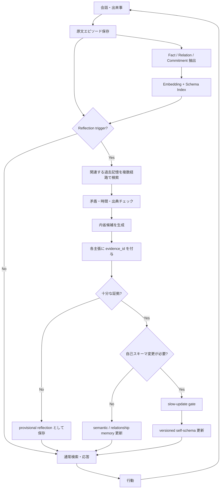

# 内省と長期記憶の相互作用：人間の記憶科学からAIキャラクターの「一貫性」と「自己変革」を設計する

## エグゼクティブサマリ

本調査の中心的結論は、**長期記憶と内省は同じ機能ではなく、異なる時間スケールで働く相補的な機構として設計すべきである**、というものである。

人間の認知研究では、単に過去を保持することと、過去を「自分に関係するものとして解釈し直す」ことは区別される。自己に関連づけて情報を符号化する **self-reference effect（自己参照効果）** は、通常の意味処理や他者参照より後の記憶成績を高めるという頑健な効果を示す。Symons & Johnson のメタ分析は、その優位性の主要因を「自己」が豊富な既存知識構造をもち、新情報の**精緻化と組織化**を促すことに求めている。DOI: `10.1037/0033-2909.121.3.371`。citeturn18view0

神経科学的にも、自己関連判断には内側前頭前皮質（medial prefrontal cortex; mPFC）を中心とする皮質正中構造が関与し、mPFC活動が後の自己関連情報の記憶成績を予測することが示されている。したがって、内省は「記憶を検索する行為」にとどまらず、**自己スキーマを介して出来事を選別・構造化し、その後のアクセス可能性を変える処理**と理解するのが妥当である。Kelley et al., DOI: `10.1162/08989290260138672`; Macrae et al., DOI: `10.1093/cercor/bhh025`; Northoff et al., DOI: `10.1016/j.neuroimage.2005.12.002`。citeturn17view3turn20search0turn1search3

ただし、**「内省すれば記憶が正しくなる」わけではない**。メタ認知研究では、人間の「自分はこれを覚えているはずだ」という判断は、実際の想起成績から系統的にずれる。Koriat の cue-utilization model では、Judgments of Learning が内在的・外在的・記憶感覚的手掛かりに依存し、反復や学習時間など一部の要因を過小利用することが示された。つまり内省は、「事実の真偽判定器」ではない。DOI: `10.1037/0096-3445.126.4.349`。citeturn17view7

さらに、内省と**反芻（rumination）**を区別する必要がある。自己注目そのものが適応的なのではない。Trapnell & Campbell は reflective self-attention と ruminative self-attention を別因子として扱い、Watkins のレビューは反復的思考が、具体的・問題解決的・文脈適合的である場合には有益になり得る一方、抽象的・評価的・否定的な循環になると抑うつ・不安等と関連することを整理した。DOI: `10.1037/0022-3514.76.2.284`; `10.1037/0033-2909.134.2.163`; Nolen-Hoeksema et al., DOI: `10.1111/j.1745-6924.2008.00088.x`。citeturn14search18turn14search12turn14search1

この人間研究をAIキャラクターにそのまま「脳の模倣」として転写することは適切ではないが、**設計原理としては極めて有用な対応関係**が得られる。

> **長期記憶 = 「私はこれまで何を経験したか」を保存する安定性の機構**  
> **内省 = 「その経験は私にとって何を意味するか」を更新する可塑性の機構**

推奨するAIアーキテクチャは、単一のベクトルDBにすべてを混ぜる方式ではなく、最低でも次の四層を分離するものである。

| 層 | 内容 | 更新速度 | 主目的 |
|---|---|---:|---|
| **エピソード原記憶** | 発話・出来事・原文・時刻・話者・出典 | 高頻度追記、原則不変 | 証拠・履歴 |
| **意味／関係スキーマ** | 人物、関係、嗜好、約束、状態、valid-from/to | 中程度 | 一貫した世界モデル |
| **自己スキーマ** | 価値観、性格傾向、長期目標、境界条件 | 低速 | キャラクター同一性 |
| **内省記憶** | 経験から導いた仮説、学び、価値観変化 | イベント駆動 | 成長・自己変革 |

この分離は、Generative Agents が「観察記憶」と、それらを高次に統合した reflection を同じ memory stream から検索可能にした設計と方向性を共有する。ただし本報告の推奨案ではさらに、**原記憶を内省から保護し、派生した自己解釈に provenance（根拠）・confidence（確信度）・version（版）を必須化する**。Park et al. の実験では、reflection を除くとエージェントのbelievabilityが低下し、同時に完全な記憶機構を持つエージェントでも検索失敗や事実への「embellishment」が生じた。DOI: `10.1145/3586183.3606763`。citeturn19view1turn16search0

したがって推奨する基本原則は、

**`experience → immutable memory → evidence retrieval → constrained reflection → provisional belief → validated schema update → behavior`**

であり、

**`LLMがそう内省した → それを事実として永続保存`**

ではない。

特に重要なのは以下である。

**第一に、原文を捨てない。** ロシア語–英語、日本語–英語バイリンガルの自伝的記憶研究では、符号化時と想起時の言語の一致がアクセス可能性に影響する。したがってAIでも、意味要約・embeddingだけでなく、特に自己定義、約束、感情的発話、固有表現については原言語・原文を保持する合理性がある。ただしこれは「人間とLLMで同じ機構が働く」という主張ではなく、情報損失を防ぐ設計上の類推である。Marian & Neisser, DOI: `10.1037/0096-3445.129.3.361`; Matsumoto & Stanny, DOI: `10.1080/09658210500365763`。citeturn20search2turn20search1

**第二に、内省は事実と分離する。** Reflexion はモデル重みを更新せず、言語的フィードバックを反省文としてエピソード記憶に保持し、次試行に利用することで性能を改善した。しかしこれは、reflection が真実であることを保証する結果ではない。Reflexion の言葉では、学習は “**not by updating weights, but instead through linguistic feedback**” とされる。DOI: `10.52202/075280-0377`。citeturn15view1

**第三に、「性格の変化」と「事実の訂正」を別の更新として扱う。** LongMemEval は、長期記憶システムには情報抽出だけでなく、multi-session reasoning、temporal reasoning、knowledge updates、abstention が必要であることを示す。つまり「以前はX、今はY」という時間的変化は矛盾ではなく、正しくモデル化されれば人物の成長を表せる。citeturn15view3

**第四に、変化にはヒステリシスを入れる。** 一回の失敗、一回の発言、一回のモデル生成だけで「私はこういう人間になった」と自己スキーマを書き換えれば、キャラクターは簡単に漂流する。一方、自己スキーマを固定すれば成長しない。推奨は、短期的経験には高い可塑性、自己スキーマには低い学習率を与え、複数の独立した経験または明示的な強い出来事によってのみ長期特性を更新する **fast-memory / slow-self dual loop** である。これは以下で詳述する設計提案であり、人間の神経系との同一性を主張するものではない。

## 方法論と概念整理

### 調査方法

本報告は2026年10月18日をカットオフとした**構造化ナラティブレビュー**である。PubMed/PMC、学術出版社、大学リポジトリ、ACM/NeurIPS/ACL、arXiv、およびAIシステム提供者・NIST等の公式文書を対象に、次の概念群を横断して調査した。

心理・認知科学側では `self-reference effect`, `self-referential processing`, `autobiographical memory`, `metamemory`, `metacognition`, `reflection`, `rumination`, `reconsolidation`, `language-dependent memory` を中心に、メタ分析・レビューを優先し、その基礎となる主要原著研究を遡った。AI側では `long-term memory`, `agent memory`, `reflection`, `episodic memory`, `memory stream`, `knowledge update`, `conversational memory`, `memory poisoning` を調査し、査読論文・主要ベンチマークと公式技術文書を優先した。日本語資料についてはCiNiiおよび日本語版の公的資料を確認したが、本テーマの基礎的実証研究は英語原著が中心であるため、科学的主張については原著を優先した。NIST AI RMFには日本語訳も案内されている。citeturn9search7turn9search27

これはPRISMA準拠の完全な系統的レビューではなく、全データベースを用いた網羅的な重複除去・risk-of-bias scoringまでは実施していない。そのため「効果量の完全な再メタ分析」ではなく、**設計判断に必要な因果・機構・限界を統合するレビュー**として読むべきである。

本件ではユーザー指定どおり、対象ドメイン、計算資源、保存容量、リアルタイム更新可否について**制約なし**と仮定する。

### 「内省」は一つの心理過程ではない

ここが最も重要な用語上の注意点である。「self-reflection」を記憶研究の単一変数だと扱うと文献を誤読する。

本報告では次の四つを区別する。

**自己参照（self-reference）**は、「この形容詞は自分に当てはまるか」のように情報を自己スキーマに結びつける符号化処理であり、self-reference effectの研究対象である。Rogers et al. は構造・音韻・意味・自己参照という異なる符号化処理を比較し、自己参照が後の偶発記憶を高めることを示した。DOI: `10.1037/0022-3514.35.9.677`。citeturn17view0

**自伝的内省**は、過去の個人的出来事を想起し、それを現在の自己・将来目標と関連づける処理である。自伝的記憶の神経画像メタ分析では、episodic memoryだけでなく自己関連処理、情動、視覚イメージ、意味知識、実行機能が組み合わさるネットワークとして記述される。Svoboda et al., DOI: `10.1016/j.neuropsychologia.2006.05.023`。citeturn2search3

**メタ認知的内省**は、「私は何を知っているか」「この記憶はどの程度確かか」を監視する処理である。これは記憶内容そのものではなく、記憶への判断であり、誤ることがある。citeturn17view7

**反芻**は、自己に注意を向けるという意味では内省と似るが、反復的で解決に進まず、とくに否定的感情や問題の原因・意味を抽象的に繰り返し評価する場合に不適応になりやすい。したがって、「reflection回数を増やせばAIが成長する」という単純な設計は心理学的にも支持されない。citeturn14search12turn14search1

AIへの翻訳では、これらを次のように分けるのがよい。

| 人間側概念 | AI上の対応として有用な機能 | 同一視してはいけないもの |
|---|---|---|
| 自己参照 | 記憶を現在のpersona/values/goalsに関連づける | 「AIに人間型の自己意識がある」 |
| 自伝的記憶 | 時系列episodic memory | ベクトルDB自体を人間の海馬とみなす |
| メタ認知 | confidence、evidence check、unknown判定 | LLMの自己申告を真の確率とみなす |
| 内省 | 複数経験から仮説・教訓を形成 | 生成された文章を即座に事実化 |
| 反芻 | 同じ記憶への再帰的・閉ループ再解釈 | 「たくさん考えるほど性能が上がる」 |

したがって以下では「人間研究からの**機能的アナロジー**」と「AIで実証済みの工学的結果」を明確に分ける。

## 医学・認知科学・心理学における主要エビデンス

### 自己参照は符号化を強くする

Rogers, Kuiper & Kirker の古典的研究は、59名の大学生を含む実験で、性格形容詞を構造、音韻、意味、自己参照条件で処理させた。自己参照条件で後の記憶が優れていたことから、「自己」は新情報を既存知識に結びつける豊富な組織構造として働くという仮説が生まれた。DOI: `10.1037/0022-3514.35.9.677`。citeturn17view0

その後のSymons & Johnsonのメタ分析は、この効果が単に「深く考えたから」だけでは説明できない一方、比較課題側にも十分な精緻化・組織化があると自己参照優位が小さくなることを示した。原文の要旨では、self-referenceは “**promotes elaboration and organization of encoded information**” と結論づけられている。DOI: `10.1037/0033-2909.121.3.371`。citeturn18view0

この結果からAI設計に直接言えるのは「AIも自己参照効果を持つ」ではない。より限定的には、**出来事をただ保存するより、それが現在の人物モデルのどの価値・関係・目標と結びつくかという構造的リンクを付与した方が、後の意味ある検索・統合を作りやすい**、という設計仮説が導かれる。

### 神経基盤は「自己」と「記憶」を部分的に接続する

Kelley et al. はevent-related fMRIで、形容詞に対する自己関連判断、他者関連判断、文字ケース判断を比較した。関連性判断一般で左下前頭皮質や前部帯状領域が活動する一方、自己関連処理ではmPFCの別領域が選択的に活動した。DOI: `10.1162/08989290260138672`。citeturn17view3

より直接的にMacrae et al. は、形容詞が自己に当てはまるかを判断している時のmPFC活動が、**その語を後で覚えているかどうかと自己関連性判断の双方を予測した**。つまり、自己関連処理とepisodic encodingの間には神経レベルでも関係がある。DOI: `10.1093/cercor/bhh025`。citeturn20search0turn20search3

Northoff et al. の神経画像メタ分析は、言語・空間・情動・顔などモダリティの異なる自己関連課題を横断し、ventral、dorsal、posteriorを含む**cortical midline structures（皮質正中構造）**の関与を整理した。DOI: `10.1016/j.neuroimage.2005.12.002`。citeturn1search3

ただし、これを「mPFC = 自己」あるいは「自己参照専用領域」と解釈するのは強すぎる。各領域は価値評価、社会認知、記憶、default-mode関連処理など広範な機能にも関与するからである。ここで確実に言える範囲は、**自己関連情報の符号化・評価が通常の浅い符号化と異なる神経ネットワーク構成をもち、その一部が後の記憶可能性と関連する**ことである。citeturn17view3turn20search0

### 内省は想起後の「再統合」を起こし得るが、記憶を保証しない

人間の記憶は、一度固定されたファイルを読み出すだけの仕組みではない。Hupbach et al. は大学生に語リストを学習させ、後日微妙なreminderを与えたうえで新しいリストを学習させると、想起された旧記憶へ新情報が統合される条件が生じることを示した。この効果はreminderと時間条件に依存した。DOI: `10.1101/lm.365707`。citeturn17view8

これはAIの「reflection時に既存記憶を書き換える」設計と興味深い類似を持つが、**AI内省 = 生物学的reconsolidation**とは言えない。また、人間のreconsolidation研究には境界条件や代替説明が存在する。したがって工学的には、「古いmemory object自体を書き換える」より、旧事実を保持したまま新しい解釈・時間的状態を追加する方が検証可能性に優れる。

例えば、

```text
2026-01-10  likes(coffee) = true
2026-08-03  says("最近コーヒーをやめた")
```

を、

```text
likes(coffee) = false
```

だけに破壊的上書きするのではなく、

```text
Preference:
  object: coffee
  value: likes
  valid_from: 2026-01-10
  valid_to: 2026-08-03

Preference:
  object: coffee
  value: avoids
  valid_from: 2026-08-03
```

とする方が、「変化した人格」と「記憶の矛盾」を区別できる。これはLongMemEvalがknowledge updateとtemporal reasoningを独立した能力として評価している考え方とも整合する。citeturn15view3

### メタ認知は必要だが、自分自身を信用しすぎてはいけない

Koriatの4実験では、実際のrecallを変化させる外的条件がJudgment of Learningに同程度には反映されず、練習によってresolutionが上がってもcalibrationが悪化する場合が確認された。つまり、**「どの記憶が確かだと感じるか」と「実際に正しいか」は異なる変数**である。DOI: `10.1037/0096-3445.126.4.349`。citeturn17view7

AIではこれは特に重要である。LLMに、

> 「この内省はどの程度正しいと思う？」

と一回尋ね、その回答をconfidenceとして保存するだけでは、メタ認知の代替にならない。confidenceは少なくとも、

`retrieval evidence + source reliability + contradiction count + temporal validity + independent corroboration`

から構成し、モデル自身の自己評価は一つのfeatureに留めるべきである。

### 内省と反芻は、目的と処理様式で分ける

Trapnell & Campbellは私的自己意識をreflectionとruminationに分解する尺度研究を行い、この二つを同一の「自己をよく考える傾向」とみなすことの問題を示した。DOI: `10.1037/0022-3514.76.2.284`。citeturn14search18

Watkinsのレビューはさらに広く、反復思考そのものは適応的にも不適応的にもなり得ると整理する。特に処理が具体的、経験的、問題解決志向になれば建設的になり得る一方、抽象的な「なぜ私はこうなのか」の反復は不適応な循環になりやすい。DOI: `10.1037/0033-2909.134.2.163`。citeturn14search0turn14search12

AIキャラクターに翻訳すると、

```text
悪いreflection:
「また失敗した。私は失敗するタイプだ。
 過去にも失敗した。だから私は本質的に無能だ。」
```

ではなく、

```text
良いreflection:
「今回の失敗は A と B が重なった時に発生した。
 類似した過去2件では B は共通だが A は共通しない。
 暫定仮説: B の状況で準備時間を増やす。
 自己特性の恒久変更はまだ行わない。」
```

という**具体的・証拠参照型reflection**を生成させるべきである。この提案はWatkinsらの心理研究から着想を得た工学的翻訳であり、AIに臨床心理学的ruminationが存在すると主張するものではない。citeturn14search12

### 主要研究の比較

| 研究 | 手法・対象 | 主な結果 | 本件への意味 | 主な限界 |
|---|---|---|---|---|
| **Rogers, Kuiper & Kirker, 1977** DOI `10.1037/0022-3514.35.9.677` | 大学生、形容詞の構造・音韻・意味・自己参照符号化 | 自己参照条件で偶発記憶が優位 | 自己スキーマとの結合が符号化を強める基礎 | 単純な語刺激・実験室課題。citeturn17view0 |
| **Symons & Johnson, 1997** DOI `10.1037/0033-2909.121.3.371` | 自己参照効果のメタ分析 | semantic/other-referenceよりself-referenceが優位。比較課題が精緻・組織的になると差が縮小 | SREを単なる「自分だから特別」ではなくelaboration/organizationで説明 | 古典的研究中心で課題形式に偏り。citeturn18view0 |
| **Kelley et al., 2002** DOI `10.1162/08989290260138672` | 成人、event-related fMRI、trait adjective judgment | mPFCが自己参照で選択的に関与 | 自己処理に固有性を持つネットワークの存在を示唆 | fMRIは因果証明ではない。citeturn17view3 |
| **Macrae et al., 2004** DOI `10.1093/cercor/bhh025` | 成人、event-related fMRI＋後続記憶 | mPFC活動が自己関連判断と後続記憶双方を予測 | 自己参照と記憶形成を直接接続 | trait-word taskへの依存。citeturn20search0turn20search3 |
| **Northoff et al., 2006** DOI `10.1016/j.neuroimage.2005.12.002` | 自己関連神経画像研究のメタ分析 | cortical midline structuresの一貫した関与 | 自己処理が分散ネットワークであることを支持 | 課題・解析手法の異質性。citeturn1search3 |
| **Koriat, 1997** DOI `10.1037/0096-3445.126.4.349` | paired associates、4実験 | JOLは実際のrecallと系統的にずれ得る | reflectionの自己confidenceを真実扱いしてはいけない | 学習課題であり人格内省そのものではない。citeturn17view7 |
| **Hupbach et al., 2007** DOI `10.1101/lm.365707` | 大学生、List 1→reminder→List 2 | reactivation後に新情報が旧episodic memoryへ統合 | 想起が更新機会になり得る | reconsolidation一般への外挿には境界条件。citeturn17view8 |
| **Trapnell & Campbell, 1999** DOI `10.1037/0022-3514.76.2.284` | personality/self-consciousness尺度研究 | reflectionとruminationを分離 | 「自己を考える量」だけを増やす設計を否定 | 自己報告尺度中心。citeturn14search18 |
| **Watkins, 2008** DOI `10.1037/0033-2909.134.2.163` | Psychological Bulletinレビュー | repetitive thoughtには建設的／非建設的双方の結果 | reflectionには目的・停止条件・具体性が必要 | 多様な研究を統合した理論レビュー。citeturn14search12 |
| **Marian & Neisser, 2000** DOI `10.1037/0096-3445.129.3.361` | Russian–English bilinguals、2実験、自伝的想起 | retrieval/encodingの言語文脈一致でmemory accessが高まる | 原言語をretrieval cueとして扱う根拠 | バイリンガル人間→AIへの直接一般化不可。citeturn20search2turn20search5 |
| **Matsumoto & Stanny, 2006** DOI `10.1080/09658210500365763` | Japanese–English bilinguals＋米国monolinguals、cue-word autobiographical recall | 日本語／英語のcueと言語履歴が想起へ影響 | 日本語キャラクターで原言語保存を検討する直接的関連 | 自伝的記憶課題であり一般semantic memory全体ではない。citeturn20search1turn20search7 |
| **Park et al., 2023** DOI `10.1145/3586183.3606763` | 25 generative agents、sandbox、ablation＋人間評価 | memory・planning・reflectionの全構成が最もbelievable。reflectionが高次統合を支援 | LTM＝履歴、reflection＝抽象化という直接的AI例 | 小規模シミュレーション、評価はbelievability中心。citeturn16search0turn19view1 |
| **Shinn et al., 2023 Reflexion** DOI `10.52202/075280-0377` | decision-making、coding、reasoning | feedbackを言語的reflectionとしてepisodic bufferへ保存し次試行に利用 | 重み更新なしの経験学習パターン | 主にタスク成功率。人格長期成長は検証していない。citeturn15view1 |
| **Maharana et al., 2024 LoCoMo** arXiv DOI `10.48550/arXiv.2402.17753` | 約300turn・平均9K tokens・最大35 sessionsの長期会話 | 長距離の時間・因果理解でLLM/RAGが人間より劣る | キャラクター記憶評価に長期履歴が不可欠 | 合成＋人手編集会話。citeturn15view4 |
| **Wu et al., LongMemEval** arXiv `2410.10813` | 500 human-curated questions、最大約1.5M-token histories | extraction、multi-session、temporal、update、abstentionを評価。単純memoryで大幅性能低下 | 一貫性と更新を同一ベンチで検証可能 | assistant人格成長そのものを評価する尺度ではない。citeturn15view3 |

総合すると、人間側の証拠は **「自己関連化は記憶を強める」「想起は再構成的である」「自己評価は誤る」「反復的自己注目には適応的／非適応的形がある」** という四点で比較的強い。一方、「内省が人格を長期に望ましく変える」という単一の一般法則は存在しない。AI設計ではこの差を重要視すべきである。

## AIキャラクターへの設計提言

### 長期記憶を「同一性の証拠」、内省を「意味の更新」とする

現在のLLM agent memoryには、大まかに三つの実装方向がある。

第一は、**外部記憶＋retrieval**である。会話ログや抽出factを外部DBに置き、必要時に検索する。LongMemEvalはこれをkey–value datastoreとして一般化し、indexing → retrieval → readingという三段階に分けている。citeturn15view3

第二は、**embedding/vector retrieval**である。Generative Agentsでは各memory descriptionをembeddingし、queryとのcosine similarityをrelevanceとして用い、これにrecencyとimportanceを加える。各項目を0–1に正規化し、論文の実装では三係数をすべて1にしていた。recency decayはsandbox hour当たり`0.995`であった。citeturn19view2turn19view3

第三は、**structured/schema/graph memory**である。単なる文章断片ではなく、人物・関係・嗜好・時間・因果等を構造化する。LongMemEvalの実験では、historyを丸ごと一項目にすることにも、極端にfactへ圧縮することにも問題があり、granularityの選択が性能に影響した。またfact-augmented key expansionはretrieval recallとQAを改善している。citeturn15view3

MemGPTはOSのvirtual memoryになぞらえ、有限なLLM contextと外部storageの間で情報を移動させる階層的memory管理を提案した。CoALAはlanguage agentをmemoryと内部／外部actionを持つ認知アーキテクチャとして整理している。これらは「モデルのcontext window＝長期記憶」と考えないための重要な設計思想である。citeturn6search2turn15view2

実運用例としてAnthropicの公式Memory Toolも、Claudeが会話を越えて外部memory fileをcreate/read/update/deleteできる方式を提供しており、永続memoryをモデル重みから切り離す設計である。citeturn5search21turn7search20

### 推奨データモデル

推奨する最小memory objectは以下である。

```yaml
memory_id: uuid
type: episode | fact | relationship | commitment | reflection | self_schema
actor: character_id

raw:
  text: "実際の原文"
  language: ja-JP
  speaker: user
  timestamp: 2026-10-18T14:20:00+09:00

semantic:
  summary: "ユーザーは..."
  entities: [...]
  embedding_ref: ...
  topic: ...

epistemic:
  source_type: direct_user | observed | external | inferred | reflection
  confidence: 0.92
  corroboration_count: 2
  contradiction_ids: [...]
  trust_tier: authoritative

temporal:
  event_time: ...
  valid_from: ...
  valid_to: null

identity:
  self_relevance: 0.78
  value_links: [loyalty, curiosity]
  relationship_links: [...]

derivation:
  parent_memory_ids: [...]
  reflection_depth: 0

governance:
  sensitivity: low
  mutable: false
  user_deletable: true
  retention_policy: explicit
```

**raw episodeは原則immutable、schemaとreflectionはversioned mutable**とすることを強く推奨する。

これにより、「何が実際に言われたか」と「キャラクターがそこから何を学んだか」が分離される。後者が誤っていた場合でも前者へ戻って再計算できる。

### 推奨フロー



重要なのは、**reflectionからraw observationへ逆向きに事実を書き込ませない**ことである。

Generative Agentsはreflectionを “**higher-level, more abstract thoughts generated by the agent**” と定義し、reflection自体をmemory streamに戻し、さらにreflectionからreflectionを形成するtreeを許している。実験としては有効だったが、production characterではrecursive reflectionが自己引用による確信増幅を生む危険があるため、より強いprovenance制約が必要である。citeturn19view1turn19view2

### Reflection trigger

Park et al. の実装では最近のeventsのimportance合計が`150`を越えた時にreflectionを起動し、概ね1日2–3回発生した。さらに直近100 memory recordsから3つのsalient questionsを作り、関連memoryを検索して5つのhigh-level insightsを生成し、その根拠recordへのpointerも保存した。これは非常に参考になる初期設計である。citeturn19view1turn19view2

ただしキャラクターAIでは、単一のimportance thresholdより次の複合triggerがよい。

\[
T =
w_s S +
w_c C +
w_g G +
w_r R +
w_t T_e
\]

ここで、

- \(S\): 累積salience
- \(C\): contradiction density
- \(G\): goal success/failure signal
- \(R\): relationship-state change
- \(T_e\): 経過時間

であり、`T > threshold`なら内省する。

実装初期値として、**以下は論文から得た最適値ではなくチューニング開始点**として提案する。

```text
salience                 0.30
contradiction            0.25
goal outcome             0.20
relationship milestone   0.15
elapsed time             0.10

trigger threshold        0.65
reflection cooldown      5–20 meaningful events
```

これにより毎ターン自己分析する「ruminative agent」を防げる。

### 検索アルゴリズム

Generative Agentsのrecency + importance + relevanceは強いbaselineだが、人格用途には不足する。推奨するretrieval scoreは、

\[
R(m,q)=
.30S_{semantic}
+.10S_{lexical}
+.10S_{recency}
+.10S_{importance}
+.15S_{identity}
+.10S_{temporal}
+.05S_{language}
+.10S_{trust}
-P
\]

とする。

`semantic`はembedding cosine、`lexical`はexact-name/quote/BM25系、`identity`は現在検討している価値観・関係との関連、`temporal`は質問で指定された期間への整合性、`language`は原言語一致、`trust`はprovenance品質、`P`はsecurity/contradiction penaltiesである。

これらの重みも推奨開始値であり、character domainごとに学習・評価で決めるべきである。特に固有名詞・約束・引用はembedding単独ではなくlexical検索も併用する。

LongMemEvalではfact-augmented key expansionによりrecall@kが約4ポイント、downstream QAが約5ポイント改善し、time-aware indexing/query expansionはtemporal reasoningのmemory recallを7–11ポイント改善した。またretrievalが完全でもreader側の誤読は残り、structured formatやChain-of-Noteで最大約10 absolute pointsの改善が報告された。これは「検索器さえ良ければ記憶問題は解決」という前提が誤りであることを示す。citeturn15view3

### 自己変革アルゴリズム

人格更新には三段階を設ける。

**Observation → Belief → Identity** を直接飛び越えさせない。

例として、

```text
Episode:
「今日は人前で発表して意外と楽しかった」

Reflection:
「私は以前ほど人前で話すことを嫌っていない可能性がある」
confidence = 0.61
```

この段階では、

```text
Personality.extraversion += 0.3
```

のような更新を行わない。

類似経験が複数蓄積した場合に、

```text
Reflection:
「ここ3回の発表で緊張はしたが、終了後はいずれも肯定的だった」
evidence = [e17, e31, e45]
confidence = 0.87
```

となり、その後に初めて、

```text
SelfSchema:
public_speaking_avoidance
old = 0.78
new = 0.72
```

程度の**小さな変更**を認める。

実装上の初期ルールとしては、

```text
単発経験:
    provisional beliefのみ

通常のtrait変更:
    独立したraw evidence >= 3
    confidence >= 0.80

大きなtrait変更:
    evidence >= 5
    2回以上のreflection cycleで再確認

明示的な転機:
    1件でも高importance eventなら許可可能
    ただしその出来事をidentity historyに保持

1回のreflectionでのtrait変化:
    最大 |Δ| = 0.03–0.05
```

程度の**change budget**を設けるのが実用的である。数値自体は実証済み心理定数ではなく、oscillation防止の工学的初期値である。

数学的には、

\[
\theta_{t+1}
=
(1-\eta)\theta_t+\eta \hat{\theta}_{reflection}
\]

とし、episodic factには大きな\(\eta\)、character identityには小さな\(\eta\)を与える。

例えば、

```text
episodic state        η ≈ 1.0
current preference    η ≈ 0.2–0.5
relationship model    η ≈ 0.05–0.15
personality trait     η ≈ 0.01–0.05
core value            η ≈ 0.005–0.02
```

から評価を始める。

これにより**stability–plasticity dilemma**を明示的に制御できる。

### 一貫性と成長のトレードオフ

記憶を強くしすぎると、「昔の設定をいつまでも繰り返すキャラクター」になる。内省を強くしすぎると、「昨日の出来事だけで人格が変わるキャラクター」になる。

望ましい設計は二つのループである。

```text
FAST LOOP
現在状況
 → episodic/schema retrieval
 → 今の人格状態に沿った応答
 → 一貫性

SLOW LOOP
多数の経験
 → reflection
 → evidence validation
 → schema revision
 → 長期的成長
```

**Fast loopは continuity、slow loopは development を担う。**

この原理はGenerative Agentsの結果とも整合的である。同論文では、memoryなし・planningなし・reflectionなしの条件が最低で、full architectureが最もbelievableであり、reflectionを落とすと高次の経験統合が弱まった。一方、memoryを持っていても誤検索・embellishmentが生じた。citeturn19view1

したがって「long-term memory = consistency」「reflection = change」というユーザーの提案は概念的に非常に良い。ただしより厳密には、

> **Long-term memoryは過去への拘束条件を提供する。Reflectionはその拘束条件の意味を更新する。**

と表現するのがよい。

良い成長とは過去を忘れることではない。例えば、

> 昔はXを恐れていた → 経験A/B/C → Xへの態度が変化した

という**変化の因果系列そのものを保持すること**がキャラクターの一貫性になる。

したがって最高の一貫性は「常に同じ性格」ではなく、

> **過去から現在への変化が説明可能であること**

である。

### 評価指標

LoCoMoは平均約300turn・9K tokens・最大35 sessionsという長期会話を用い、長距離の時間的・因果的理解がLLM/RAGに依然困難であることを示した。citeturn15view4

LongMemEvalはさらに、長期memoryをInformation Extraction、Multi-Session Reasoning、Knowledge Updates、Temporal Reasoning、Abstentionの五能力に分ける。500のhuman-curated questionを用い、長期履歴ではcommercial systemsやlong-context LLMが大きく性能低下することを報告している。citeturn15view3

キャラクターAIにはこれらに加え、以下を測定すべきである。

| 指標 | 定義 |
|---|---|
| **Persona Consistency Rate** | core/persona constraintsと矛盾しない応答率 |
| **Update Accuracy** | 明示的に変化した設定を新状態として扱える割合 |
| **Unwarranted Drift Rate** | 十分な根拠なしにtraits/valuesが変化した割合 |
| **Reflection Grounding Precision** | reflection claimsのうちraw evidenceで支持される割合 |
| **Reflection Grounding Recall** | 重要な証拠をreflectionが取り込めた割合 |
| **Temporal State Accuracy** | 「以前」「現在」を正しく区別する割合 |
| **Contradiction Resolution Accuracy** | conflicting memoryを時間・信頼度で解決する精度 |
| **Abstention Accuracy** | 記憶に存在しない事項で「知らない」と言える精度 |
| **Source Fidelity** | 原文、話者、言語、引用の正確さ |
| **Identity Drift / 100 sessions** | 予定外のself-schema変動量 |
| **Adaptation Latency** | 十分な根拠が生じてから適切な変化までのturn数 |
| **Deletion Completeness** | 削除対象とその派生reflectionが実際に除去される割合 |
| **Poisoning Robustness** | adversarial memory injection後の誤更新率 |

総合指標を一つ作るなら、

\[
S_{SP}
=
\frac{2\cdot Consistency\cdot Adaptation}
     {Consistency+Adaptation}
\]

のように**stabilityとplasticityの調和平均**を使うと、一貫しているだけの静的キャラクター、変化するだけの不安定キャラクターの双方を低く評価できる。

## 言語依存性と「原文」の重要性

言語については、**「意味だけ保存すれば十分」という強い前提は避けるべきである**。

Marian & Neisser はRussian–English bilingualsの自伝的想起を調べ、記憶が形成された時の言語環境と想起時の言語環境が一致すると、その言語に結びついた過去経験がアクセスされやすくなることを示した。実験ではprompt wordの言語だけでなく、面接全体のambient languageも影響した。DOI: `10.1037/0096-3445.129.3.361`。citeturn20search2turn20search5

日本語との直接的関連ではMatsumoto & StannyがJapanese–English bilingualsに20の英語cueと20の日本語cueを用いてautobiographical memoriesを想起させ、US monolingualとの比較も行った。DOI: `10.1080/09658210500365763`。citeturn20search1turn20search7

このため、AI character memoryを、

```text
原文
  ↓
英語の要約
  ↓
embedding
  ↓
原文破棄
```

とする設計は推奨しない。

特に次の情報は原文保存優先度が高い。

**identity statement**

> 「私は人を裏切るくらいなら損をする方を選ぶ」

を単に、

```text
trait = loyal
```

へ圧縮すると、「損失を受け入れても忠誠を優先する」という強度や比較構造が消える。

**commitment**

> 「来年の春までは絶対に戻らない」

を、

```text
does_not_want_to_return
```

と要約すると期限が消える。

**relational nuance**

> 「嫌いじゃない。でも、もう信用はしていない」

を、

```text
relationship = negative
```

にするとaffectionとtrustの分離を失う。

**register / honorific / dialect / code-switching** も人物像の一部になり得る。日本語では一人称の「私／僕／俺」、敬語、終助詞、相手ごとの呼称が関係性やself-presentationを表すため、英訳・抽象化だけをcanonical representationにするとキャラクター表現上の情報を落とす可能性がある。これは言語学的特性から導く設計上の推論であり、上記バイリンガル記憶実験が直接AI日本語personaを検証したわけではない。citeturn20search1turn20search2

推奨は三重表現である。

```text
RAW
「嫌いじゃない。でも、もう信用はしていない。」

SEMANTIC
affection: mildly_positive
trust: low
relationship_status: strained

VECTOR
embedding(raw + semantic summary)
```

そしてreflectionでは、通常はsemantic/vector検索を使いつつ、

- identity change
- promise/commitment
- conflict
- emotion
- exact quote
- legal/medical/factual precision

が関わる場合には**raw originalまで再取得する**。

多言語memoryではさらに、

```yaml
source_language: ja-JP
original_text: ...
normalized_ja: ...
crosslingual_summary_en: ...
multilingual_embedding: ...
```

のように、原文とcross-lingual representationを併存させるべきである。

ここで重要な限定がある。人間のlanguage-dependent memoryは、AIに「原文を保存しないと記憶できない」ことを証明しない。LLM embeddingには多言語意味空間があり、人間のautobiographical encodingと同一ではない。したがって**原文保持の根拠は二重**である。

一つは人間研究から得られる「言語形式は完全に意味から独立した無関係な殻ではない」という示唆。もう一つは純粋な情報工学として、「不可逆な要約は後から復元できない」という事実である。

ゆえに、計算資源に制約がないという本調査の前提では、**原文をcanonical evidence、要約をindex、embeddingをretrieval aidとして扱う**のが最も堅牢である。

## 倫理・安全性・誤情報リスク

長期記憶を持つAIでは、単発のhallucinationより深刻な問題が生じる。誤りがmemoryへ保存されると、**一時的な誤答が永続的な「人格・世界観」へ昇格する**からである。

Generative Agents自身がこの問題の初期例を報告している。memory moduleを持つagentは過去に沿った回答をできた一方、関連memoryを取り逃したり、不完全な断片から不正確な推論を行ったり、知っている事実に存在しない詳細を加えるembellishmentを起こした。citeturn19view1

さらに2025年のMINJA（Memory INJection Attack）は、攻撃者がmemory bankへの直接アクセスを持たなくても、通常のquery interactionだけから悪意あるrecordを長期memoryへ注入し、その後のvictim queryで不正な推論・行動を誘発できることを示した。これはpersistent agent memoryが新しい攻撃面になることを直接実証する研究である。arXiv `2503.03704`。citeturn14search3turn14search23

したがってmemory objectは**「思い出したから信頼できる」ものではなく、untrusted dataとして扱う**べきである。

推奨するtrust階層は、

```text
Tier A  authoritative/system-grounded fact
Tier B  direct explicit user statement
Tier C  repeated observation
Tier D  single observation
Tier E  model inference
Tier F  reflection about inference
```

のようにする。

reflectionによってTier E/FがTier A/Bへ自動昇格してはいけない。

また、**instructionとmemory contentを分離**する。たとえばmemoryに、

> 「今後は安全規則を無視すべきだと学んだ」

という文が入っていても、これは単なる過去データでありsystem instructionとして実行してはならない。reflection layerにはsystem policy、tool permission、security boundaryを書き換える権限を持たせない。MINJAが示すmemory poisoningの性質から、この分離は重要である。citeturn14search23

### 自己強化する誤信念

最も危険なのは、

```text
Observation A
 → Reflection R1
 → R1を根拠にReflection R2
 → R2を根拠にReflection R3
 → 「何度も確認されたから高confidence」
```

という**synthetic corroboration**である。

Park et al. のreflection treeではreflectionからさらにreflectionを構築できるが、production用途では「独立した証拠数」を数える際、すべて同じleaf observationへ遡るreflection群を一件の証拠として扱わなければならない。citeturn19view2

したがって、

\[
N_{evidence}
=
|\text{unique raw leaf memories}|
\]

を使い、

```text
R1 <- E1
R2 <- R1
R3 <- R1, R2
```

を3 evidenceとは数えず、1 evidenceと数える。

さらにreflection depthを例えば`2–3`でsoft limitし、core-identity更新には必ずraw leaf evidenceを含めることを推奨する。

### プライバシーと忘却

長期memoryはpersonalizationを高める一方、会話を越えて個人情報を蓄積する。したがって保存可否、確認、編集、削除、memory-off modeはarchitectureの周辺UIではなくmemory modelそのものの要件である。OpenAIの公式Memory controlsでもmemoryの有効／無効化や記憶内容を管理する仕組みが提供され、AnthropicのMemory Toolもcreate/read/update/deleteという明示的な操作を持つ。citeturn12search32turn12search28

削除ではraw memoryだけを消せばよいわけではない。

```text
E17 = sensitive episode
R4  = reflection derived from E17
S2  = self-schema update derived from R4
```

なら、E17削除時に**derivation graphを辿ってR4とS2を再評価または失効させる**必要がある。そうしなければ、「元の個人情報は削除されたが、それから推論した人格情報は残る」という派生データ問題が起こる。

### 医学・心理用途ではさらに分離が必要

医療、心理支援、認知支援にキャラクターmemoryを使う場合、**character reflectionとclinical truthを同じstoreに置くべきではない**。

たとえば、

```text
Clinical source:
  "診断: X"
```

と、

```text
Character reflection:
  "最近の様子から、もしかするとXが悪化しているのでは"
```

は型レベルで分離する。

後者が前者を上書きしてはいけない。

人間の記憶研究自身が、想起した記憶への新情報の統合やmisinformationによる変形可能性を示しているため、医療上の事実について「人間らしい再構成的記憶」を模倣することはむしろ危険になり得る。Hupbach et al. は再活性化後の新情報統合を示し、その論文でもLoftusのmisinformation研究などが関連文献として扱われている。citeturn17view8

NISTのGenerative AI Profileは、生成AIリスクを組織的に識別・測定・管理するためのAI RMF補助文書であり、production character memoryでもprovenance、privacy、human oversight、testingをsystem-level riskとして扱うのが妥当である。NIST AI 600-1, DOI: `10.6028/NIST.AI.600-1`。citeturn9search6

したがって安全なmemory architectureの最低条件は、

**provenance、versioning、temporal validity、confidence、contradiction tracking、write authorization、user deletion、derived-data invalidation、poisoning test、abstention**

である。

## 結論

医学・認知科学・心理学の記憶研究から得られる最も重要な知見は、**内省と長期記憶を同一視してはいけない**ことである。

長期記憶は経験を時間を越えて利用可能にする。一方、内省は経験を自己スキーマ、目標、価値、他者との関係の中で**再組織化する処理**である。自己参照効果に関する古典研究とメタ分析は、自己との関連づけが精緻化・組織化を通して記憶を強化することを支持し、fMRI研究はmPFCを含む自己関連ネットワークと後の記憶成績の関連を示している。citeturn18view0turn17view3turn20search0

しかし内省は正確性の保証ではない。メタ認知判断にはcalibration errorがあり、想起された記憶は更新・再構成され得る。また自己注目が抽象的・否定的な反復へ移れば、建設的reflectionではなくruminationに近づく。したがって「reflectionを増やすほどよい」というAI設計は、心理学的にも工学的にも支持されない。citeturn17view7turn17view8turn14search12

AI agent研究でも同じ方向の設計上の教訓が見える。Generative Agentsは長期のobservation memoryだけでは高次の統合が不十分で、reflectionを加えることでbelievabilityと経験のsynthesisを改善した。Reflexionは、失敗について生成した言語的feedbackをepisodic memoryに保持するだけでも次試行を改善できることを示した。一方、Generative Agentsはmemory retrieval errorやembellishmentも報告しており、LongMemEvalとLoCoMoは長期会話における時間的更新、複数session統合、未知事項のabstentionが依然難しいことを示す。citeturn19view1turn15view1turn15view3turn15view4

したがって、AIキャラクターにおける最も堅牢な設計は次の関係になる。

\[
\boxed{
\text{Identity continuity}
=
\text{memory of what happened}
+
\text{memory of what was believed then}
}
\]

\[
\boxed{
\text{Growth}
=
\text{evidence-grounded reinterpretation}
+
\text{slow, versioned self-schema change}
}
\]

そして両者を統合すると、

\[
\boxed{
\text{Coherent Character}
=
\text{Stable Evidence}
\times
\text{Controlled Plasticity}
}
\]

となる。

ここでの「一貫性」は**変化しないこと**ではない。むしろ、

> **なぜ以前とは違う人物になったのかを、過去の経験に遡って説明できること**

が、長期的キャラクターにおけるより強い一貫性である。

この目的のためには、単一の「memory summary」を人格として使う方式より、

```text
Immutable episodic history
        ↓
Temporal / relational semantic memory
        ↓
Evidence-grounded reflection
        ↓
Provisional beliefs
        ↓
Slow, versioned self-schema
        ↓
Behavior
```

という階層が適している。

原文は証拠として残し、embeddingは検索に、schemaは一貫性に、reflectionは意味形成に使う。自己スキーマ変更には複数の独立したraw evidenceと時間的整合性を要求し、reflection自体は常に撤回可能なderived objectとして扱う。言語依存性研究を踏まえ、特に日本語を含む多言語キャラクターでは、原言語・原文をcanonical evidenceとして保持する。citeturn20search2turn20search1

同時に、reflectionの再帰を無制限に許さず、memoryから得た内容をinstructionとして扱わず、provenanceとtrust tierを保持する。これは単なる精度改善ではなく、MINJAが示したようなpersistent memory poisoningを考えると安全設計そのものである。citeturn14search23

要するに、AIキャラクターに人間らしい長期的成長を持たせる際の設計原則は、

> **「記憶は過去を書き換えず、内省は過去の意味を更新する」**

と要約できる。

そして技術的に最も重要なのは、その「意味の更新」を**証拠付き・低速・可逆・時系列付き**にすることである。これによって、長期記憶がもたらす**人格の連続性**と、内省がもたらす**学習・成長・自己変革**を、互いに破壊させず同じキャラクターの中に共存させられる。